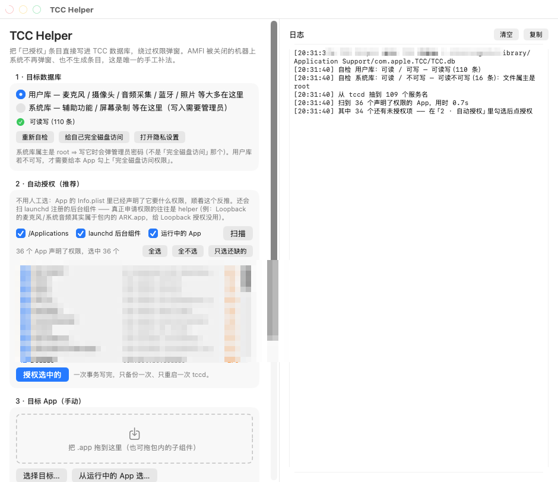

# TCC Helper —— 万能权限工具

把「已授权」条目**直接写进 macOS 的 TCC 数据库**，绕过系统权限弹窗。

**为什么需要它**：`boot-args` 里带 `amfi=0x80` / `amfi_get_out_of_my_way=0x1` 的机器（黑苹果装第三方驱动时很常见），
macOS **不再弹权限窗、也不在「隐私与安全性」里生成条目** ⇒ 麦克风、摄像头、系统音频采集、屏幕录制这类权限
永远拿不到。这是唯一的手工补法。

> **下载**：见 [Releases](../../releases) —— `TCC Helper-x.y.dmg`，挂载后把 App 拖进 Applications 即可。
> 也可以自己构建：`./build.sh`（App）/ `./make-dmg.sh`（DMG）。



---

## 构建

```sh
./build.sh          # 出 "TCC Helper.app"
./make-dmg.sh       # 出 "TCC Helper-1.0.dmg"（拖进 Applications 就能装）
```

只依赖 Xcode 命令行工具（`swiftc`），不需要 Xcode 工程文件。

**DMG 里有什么**：`TCC Helper.app` + `Applications` 软链（拖进去即安装）+ `README.md` + `tcchelper-cli`。
`make-dmg.sh` 会自动挂载成品校验结构、检查签名、打印 SHA-256。

**图标是画出来的**：`tools/make-icon.swift` 用 CoreGraphics 画 1024 底图（圆角方形 + 盾牌 + 对勾），
`tools/make-icns.sh` 拆成 iconset 交给 `iconutil` 合成 `.icns`。改设计只要改那个 Swift 文件。

**签名是 ad-hoc**（本机没有 Developer ID）。本地用没问题；
如果要把 DMG 发给别人，对方首次打开需要**右键 → 打开**（或被 Gatekeeper 拦一次）。

## 用法（GUI）

1. **目标数据库** —— 选「用户库」（麦克风 / 摄像头 / 音频采集 / 蓝牙…）或「系统库」（辅助功能 / 屏幕录制…）。
   面板上会显示自检结果；系统库属主是 root，写它时会弹**管理员密码**。
2. **自动授权（推荐）** —— 打开 App 就自动扫一遍，列出「谁声明了要什么权限、还缺几条」。
   勾选后点「授权选中的」，一次事务写完。见下面《自动授权》一节。
3. **目标 App（手动）** —— 把 `.app` 拖进虚线框，或用「选择目标…」。
   ★ **要授权的是「真正申请权限的那个组件」**，不一定是主 App。
   例：Loopback 的麦克风/系统音频权限其实属于它包内的 `Audio Routing Kit (ARK).app`（`com.rogueamoeba.arkaudiod`），
   给 `Loopback.app` 授权没用。选目标时可以**钻进 .app 内部**去选子组件。
   「从运行中的 App 选…」能直接列出在跑的后台 helper。
4. **权限服务（手动）** —— 109 个服务，运行时从系统 `tccd` 二进制里抽出来，中英文都能筛。
5. **操作** —— 预演（不写库）/ 授权 / 撤销 / 刷新条目。写入前自动备份 TCC.db，写完自动 `killall tccd`。

## 自动授权（不用人工选）

**思路**：不猜、也不靠人肉挑，而是从系统里**反推**谁需要什么权限。

**线索 ①：App 自己就声明了。** `Info.plist` 里的 usage description 就是它的权限申请清单：

| Info.plist 键 | 对应 TCC 服务 |
|---|---|
| `NSMicrophoneUsageDescription` | `kTCCServiceMicrophone` |
| `NSCameraUsageDescription` | `kTCCServiceCamera` |
| `NSAudioCaptureUsageDescription` | `kTCCServiceAudioCapture`（系统音频采集） |
| `NSAppleEventsUsageDescription` | `kTCCServiceAppleEvents` |
| `NSDesktopFolderUsageDescription` … | 桌面 / 文稿 / 下载 / 网络宗卷 / 可移除宗卷 |
| `NSBluetoothAlwaysUsageDescription` | `kTCCServiceBluetoothAlways` |

（完整映射见 `Sources/TCCAuto.swift` 的 `usageMap`。会按系统真实服务清单过滤，系统不认识的键不会写。）

**线索 ②：真正申请权限的往往是后台组件。** 所以还会扫：

- **launchd 注册的每个 job** → 解析回它所属的 `.app`（`Program` / `ProgramArguments[0]` 往上找 `.app`）；
- **包内子组件** —— `Contents/{Library/LoginItems,Library/LaunchServices,XPCServices,PlugIns,Helpers,Resources,MacOS}`；
- **组件目录** —— `/Library/Audio/Plug-Ins/HAL`（音频驱动，ARK 就在这儿）、`/Library/PrivilegedHelperTools` 等；
- 正在运行的 App。

**效果**：Loopback 那个坑，自动模式**自己就找出了 `com.rogueamoeba.arkaudiod`** 并认出它需要
`kTCCServiceMicrophone` + `kTCCServiceAudioCapture` —— 完全不用人工翻包。

CLI 版：

```sh
bin/tcchelper-cli auto                                  # 预演（只列，不写）
bin/tcchelper-cli auto --apply                          # 真正写入
bin/tcchelper-cli auto --root /Applications --no-running # 限定范围
bin/tcchelper-cli auto --service kTCCServiceAudioCapture # 只处理某一个服务
```

## 用法（CLI，和 GUI 共用同一套逻辑）

```sh
bin/tcchelper-cli services                                  # 列出全部服务
bin/tcchelper-cli inspect  <App>                            # 看 bundle id / 签名 / DR
bin/tcchelper-cli list     <App> [--db user|system]         # 列出该 App 的条目
bin/tcchelper-cli dry      <App> <service> [--db ...]       # 预演
bin/tcchelper-cli grant    <App> <service> [--db ...] [--path]
bin/tcchelper-cli revoke   <App> <service> [--db ...] [--path]
```

`--path` = 按绝对路径授权（`client_type=1`），用于没有 bundle 的裸可执行文件。

## 原理

写的是 `access` 表：

| 列 | 值 |
|---|---|
| `service` | `kTCCService…` |
| `client` | bundle id（`client_type=0`）或绝对路径（`client_type=1`） |
| `auth_value` | **2 = 允许**（0 拒绝 / 3 未决） |
| `auth_reason` | 4 = 服务策略（系统自己生成的条目用的就是这个） |
| `auth_version` | 1 |
| `csreq` | DER blob，由目标 App 的 **designated requirement** 生成 |
| `indirect_object_identifier` | 字面量 `'UNUSED'`（不是空串） |

`csreq` 生成：`codesign -d -r- <App>` 取 `designated =>` **之后**的文本 → `csreq -r- -b out.bin`。
★ magic 必须是 **`fade0c00`**；把 `designated =>` 前缀一起喂进去会得到 `fade0c01`（集合格式），TCC 不认。

## 五个踩过的坑（代码里都处理了）

1. **`codesign -dvvv -r-` 把 DR 打在 stdout、详细信息打在 stderr** ——
   只看一个流会把有签名的 App 误判成「无签名」。代码里两个流都解析。
2. **ad-hoc 签名的 App 没有显式 DR** —— codesign 打成 `# designated => cdhash H"…"`（带 `#`，是注释）。
   这种情况 `csreq` 留空，靠 Bundle ID 匹配（系统给 Apple 守护进程写的条目也是这样）。
3. **别用临时表做写权限自检** —— `create temp table` 只写 temp 库，永远「成功」，测不出主库只读。
   要用主库上的 DDL + `rollback`。
4. ★ **扫描阶段绝不能对每个 App 跑 `codesign`** —— 每次是一个子进程，36 个 App 串行要 **17–21 秒**，
   界面直接卡死。改成**惰性 + 并行**（`enrichAll`，`DispatchQueue.concurrentPerform`）后：
   扫描 **0.9s** + 签名检查 **2.1s**。
5. ★ **`systemServices()` 必须缓存** —— 它要读几 MB 的 tccd 再跑正则，而扫描会对每个 App 调一次；
   不缓存就是几十遍全量扫描。

## 注意事项

- **条目不持久**：系统大版本更新、`tccutil reset`、清理工具都会抹掉，需要重跑。
- **用户库不可读时**，给本 App 勾「完全磁盘访问权限」；也可以点面板上的「给自己完全磁盘访问」
  （写系统库，需要管理员密码）。
- **撤销**：用「撤销」按钮，或 `tccutil reset <service> <bundle-id>`。
- 这是**有意降低系统安全边界**的操作，只给确实需要的 App 授权。

## 目录

```
TCC-Helper/
├── build.sh                     # 构建 .app
├── make-dmg.sh                  # 打包 DMG
├── tools/make-icon.swift        # 画图标（CoreGraphics）
├── tools/make-icns.sh           # 合成 .icns
├── Sources/TCCCore.swift        # 核心：DB 访问 / csreq / 服务枚举 / SQL
├── Sources/TCCAuto.swift        # 自动授权：Info.plist 反推 + launchd/子组件扫描
├── Sources/TCCHelperApp.swift   # SwiftUI 界面
├── CLI/main.swift               # 命令行版（共用上面两个）
├── Resources/Info.plist
├── Resources/AppIcon.icns
├── bin/tcchelper-cli            # 构建产物
├── TCC Helper.app               # 构建产物
└── TCC Helper-1.0.dmg           # 构建产物
```
